# Forza Motorsport 2 Recompiled

An experimental static recompilation of the Xbox 360 version of Forza
Motorsport 2 using [ReXGlue](https://github.com/rexglue/rexglue-sdk).

The latest experimental source release adds a graphical settings launcher.

This repository contains project source, recompilation metadata, and build
configuration, a launcher branding image and owner-supplied screenshots. It does not contain game inputs, Xbox system files, saves,
generated translation, or compiled executables. You must provide files from
your own legally obtained copy of the game.

The independently authored project material is licensed under the BSD
3-Clause License. The license does not grant rights to Forza Motorsport 2 or
other third-party content. See [License and content boundary](docs/LEGAL.md).

Screenshots below are from the owner's 2026-10-13 release test session.

<table>
  <tr>
    <td width="50%">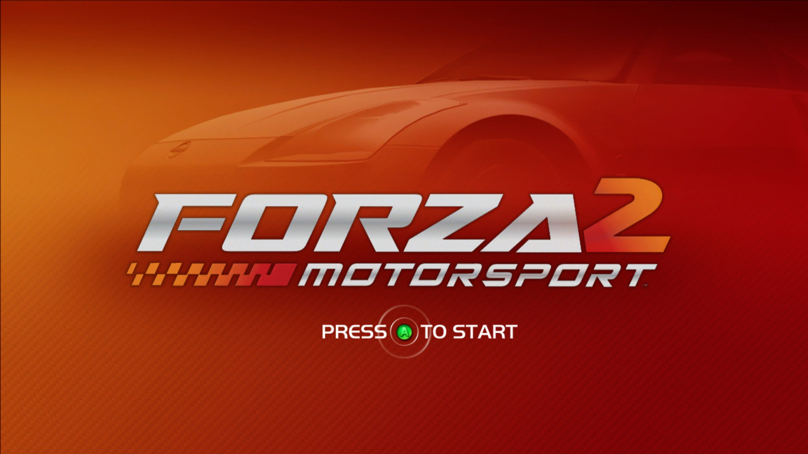</td>
    <td width="50%">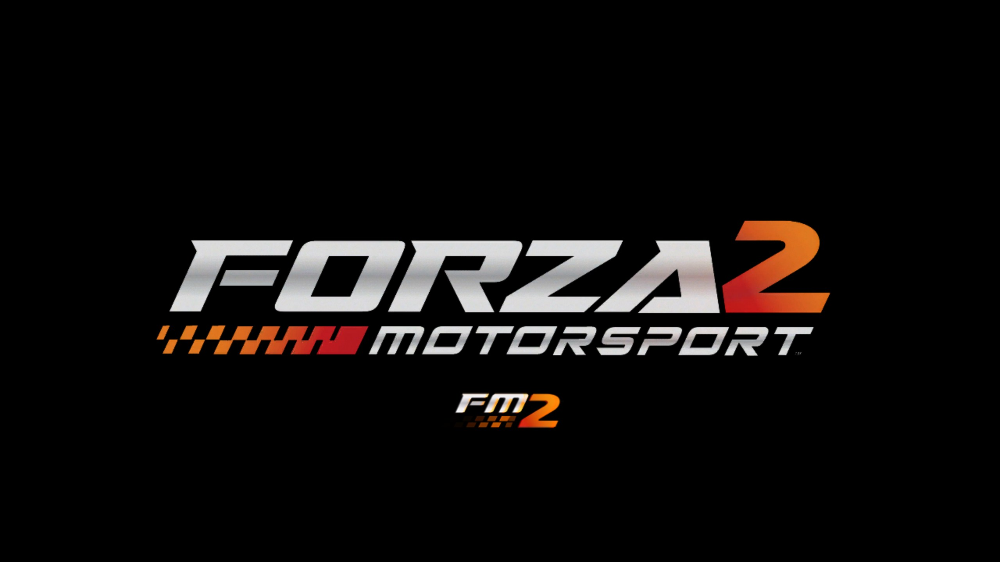</td>
  </tr>
  <tr>
    <td>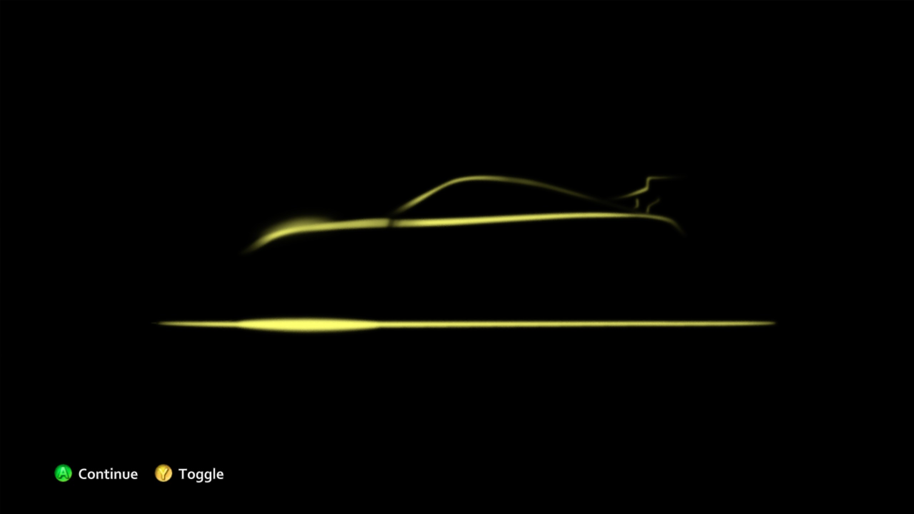</td>
    <td>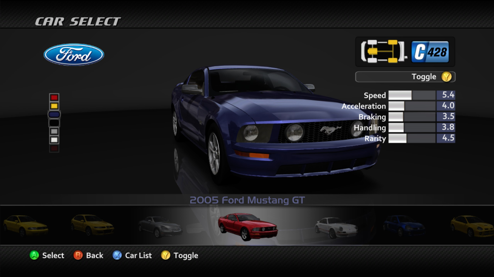</td>
  </tr>
</table>

## Project status

This is an experimental alpha source release for the European retail game:

- Title ID: `4D5307EA`
- Media ID: `3E3180AE`
- Tested host: Windows AMD64 with Direct3D 12
- SDK: continuation-aware ReXGlue revision `f16992c`

The owner completed a race, unlocked arcade cars/tracks, started career and
confirmed retained progress after save/reload during release testing on
2026-10-13. He reported no hiccups on the normal run without a debugger.
These are bounded observations; extended stability and DLC coverage on the
public base-game build remain unqualified. The newer launcher and FPS-cap
build still need an owner-run game check.

See [Current status](docs/STATUS.md) for the exact tested boundary.

<table>
  <tr>
    <td width="50%">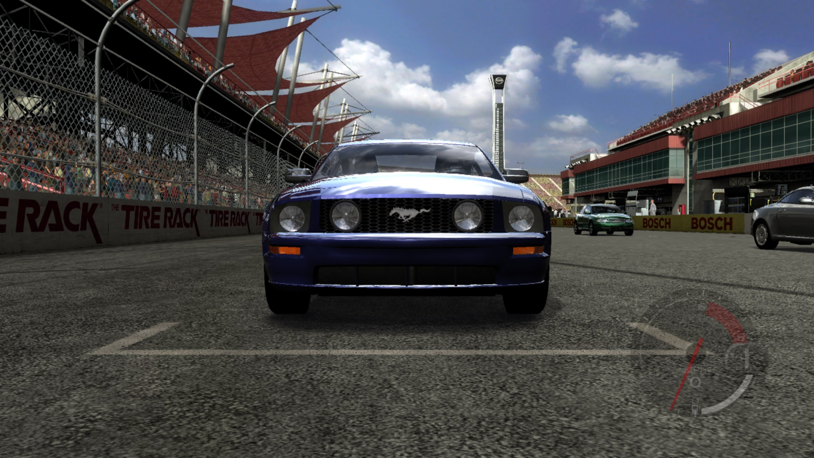</td>
    <td width="50%">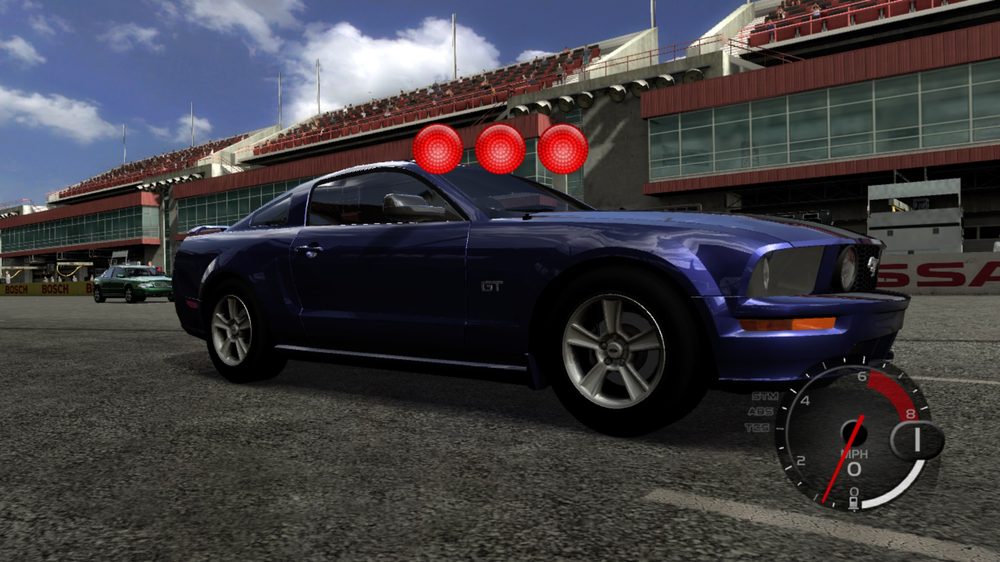</td>
  </tr>
  <tr>
    <td>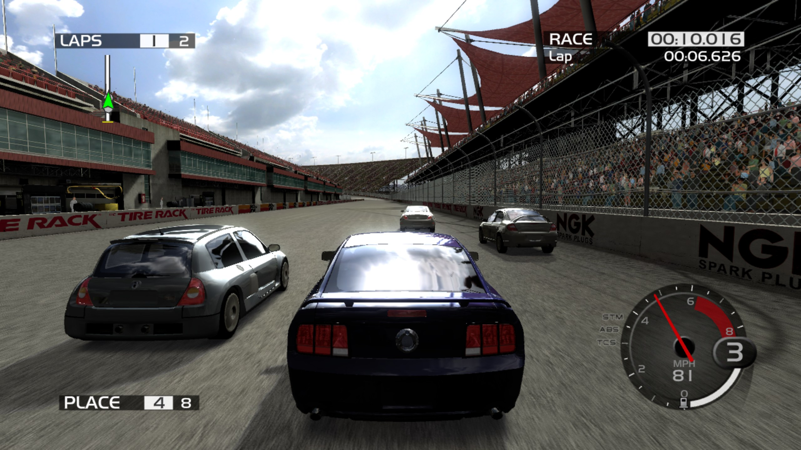</td>
    <td>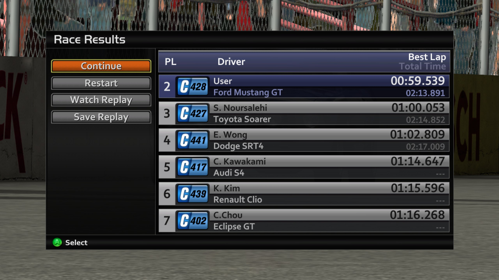</td>
  </tr>
</table>

## Requirements

- Windows 10 or 11 with an x86-64-v3-capable AMD64 CPU
- a Direct3D 12-capable GPU
- Git, CMake 3.25 or newer, Ninja, and LLVM/Clang
- Visual Studio 2022 Build Tools and a Windows SDK
- a legally obtained, extracted Forza Motorsport 2 game tree

The supported builder compares this executable with the required size and SHA-256 hash before generation:

```text
extracted/default.xex
```

The builder obtains the exact public ReXGlue fork commit recorded in
[`release/release-policy.json`](release/release-policy.json), builds the SDK,
generates translation locally, and builds FM2. Generated code and build output
remain under `.local`.

## Local build

From the repository root:

```powershell
pwsh -File .\tools\Build-Local.ps1 -GameDataRoot "D:\Games\FM2-extracted"
pwsh -File .\tools\Run-Local.ps1 -GameDataRoot "D:\Games\FM2-extracted"
```

Use `-ValidateOnly` to test source identity, the game executable, and the toolchain without an SDK build.
An extracted source archive uses `SOURCE-PROVENANCE.json`, which records its source commit and file hashes.
The builder rejects archive files that differ from those hashes.
The run script keeps profiles, saves, content, and caches under `.local/user` by default.
See [Marketplace content](docs/CONTENT.md#user-data-location) for `-UserDataRoot` and launch validation without starting FM2.

After building, open `Launch FM2 Settings.bat` for VSync, an independent FPS
cap, window resolution, fullscreen and render scale. Select your existing
profile folder to keep progress. Native 1x is the tested default; 2x has known
wavy graphics and 3x is untested. See [FM2 launcher](docs/LAUNCHER.md) for controls,
build requirements and checks. These controls are included in
`v0.1.0-alpha.2`; the earlier `v0.1.0-alpha.1` archive is unchanged.

<table>
  <tr>
    <td width="50%">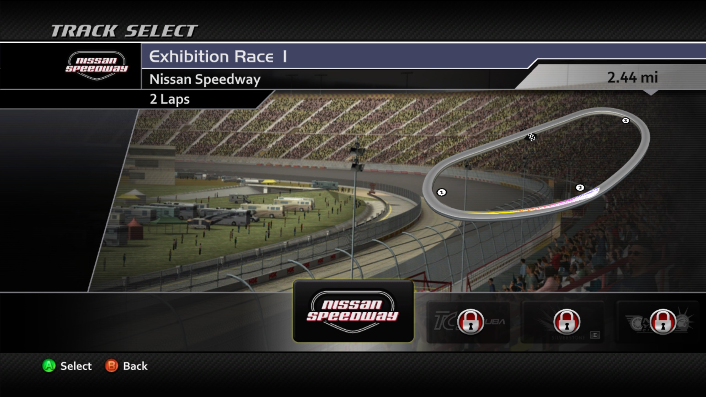</td>
    <td width="50%">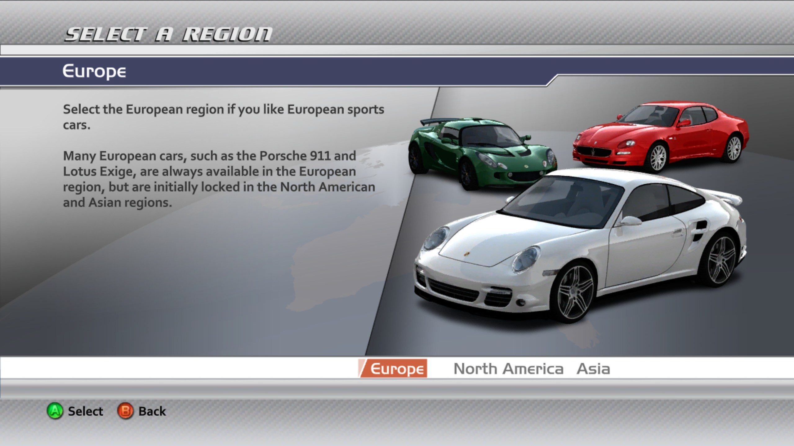</td>
  </tr>
  <tr>
    <td>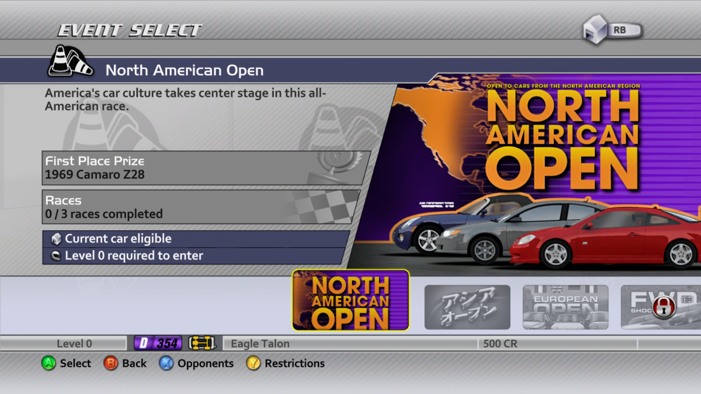</td>
    <td>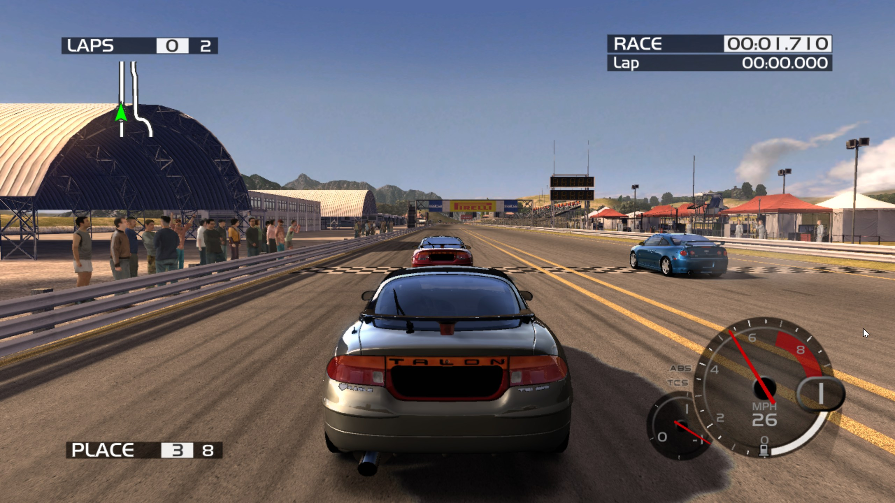</td>
  </tr>
</table>

## Marketplace content

Extract legally obtained FM2 marketplace STFS packages into one directory.
The packages normally appear below `4D5307EA/00000002` and have no extension.
Then launch with the content directory:

```powershell
pwsh -File .\tools\Run-Local.ps1 `
  -GameDataRoot "D:\Games\FM2-extracted" `
  -ContentRoot "D:\Games\FM2-content"
```

At startup, the importer reads the package header, content type, and Title ID before extraction.
It inspects existing installed headers and requires nonempty content.
It preserves incomplete installations and reports them for repair.
ZIP archives require extraction before import.

File presence does not establish in-game DLC activation or full-pack access.
See [Marketplace content](docs/CONTENT.md) for the limits and diagnostic procedure.

## Developer build

The developer build defaults to the pinned ReXGlue revision:

```powershell
cmake -S fm2 --preset win-amd64-release
cmake --build fm2/out/build/win-amd64-release --target fm2_codegen
cmake -S fm2 --preset win-amd64-release
cmake --build fm2/out/build/win-amd64-release
.\Launch FM2.bat
```

`Launch FM2.bat` expects `extracted/default.xex` at the repository root and
enables the existing intro-skip workaround.
The local telemetry launcher uses a separate instrumented build and is not a release input.

## Development notes

- [Build notes](BUILD-NOTES.md)
- [Release notes](docs/RELEASE_NOTES.md)
- [Current status and limitations](docs/STATUS.md)
- [Canonical documentation sources](docs/canonical-sources.md)

## Repository and release policy

Do not commit game files, generated translation, user data, saves, shader
caches, logs, crash dumps, SDK installations, or compiled binaries.

Public artifacts follow the [builder-first release process](docs/RELEASING.md):
source and checksums only. The repository does not authorize publishing a
precompiled FM2 executable or locally generated translation.

This project is not affiliated with or endorsed by Microsoft, Xbox, Turn 10
Studios, or the Forza franchise.
